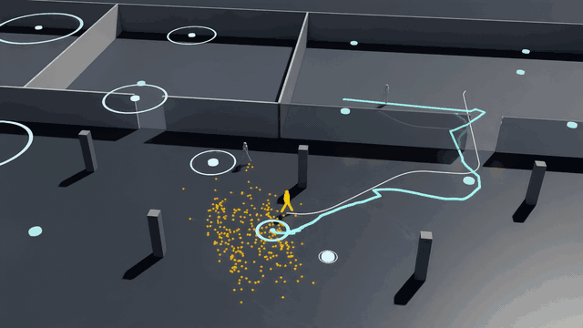
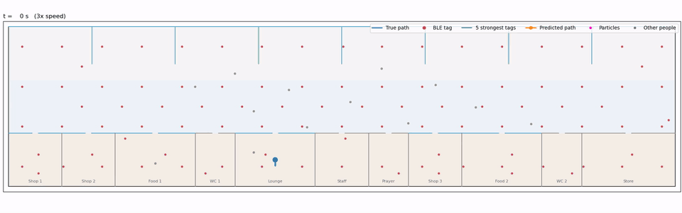
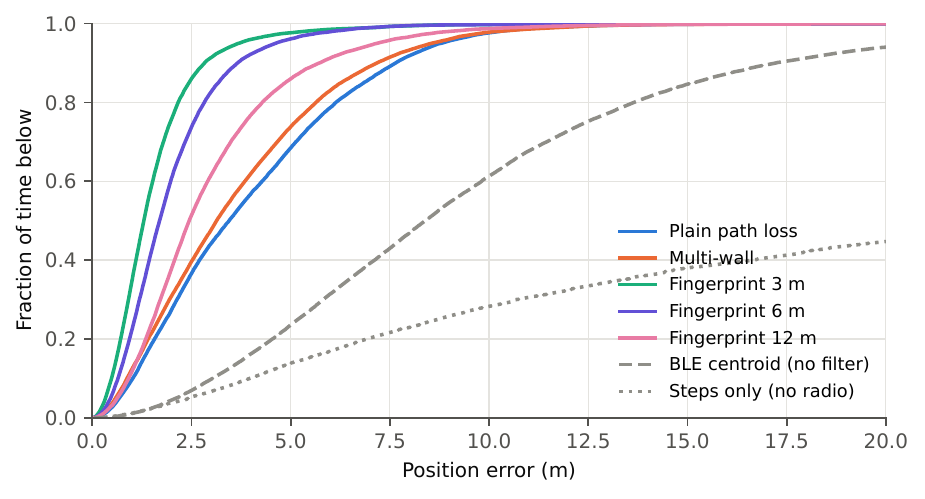
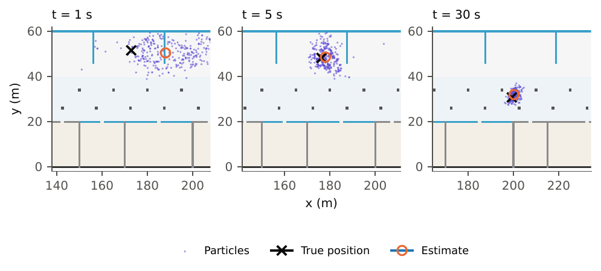
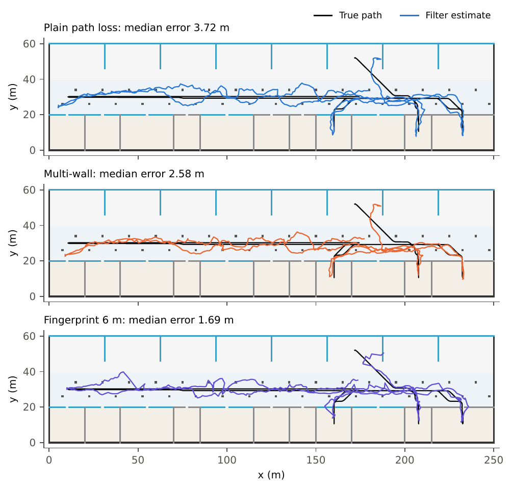
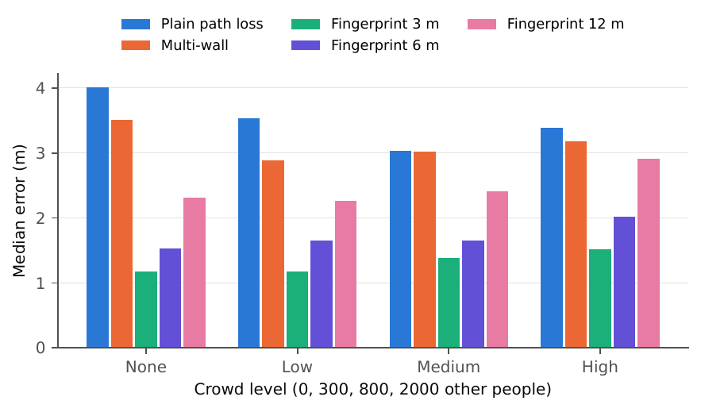
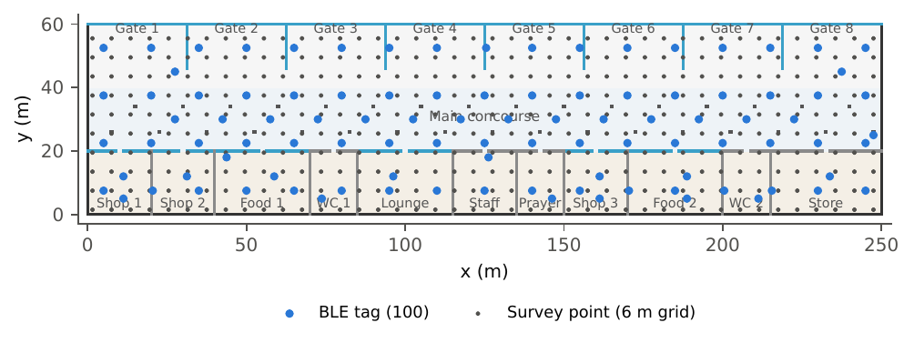
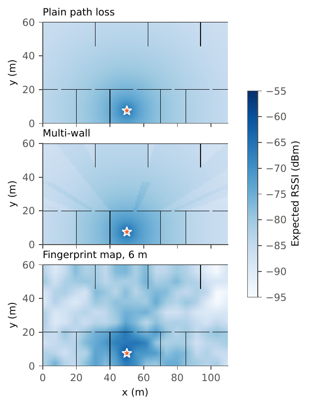
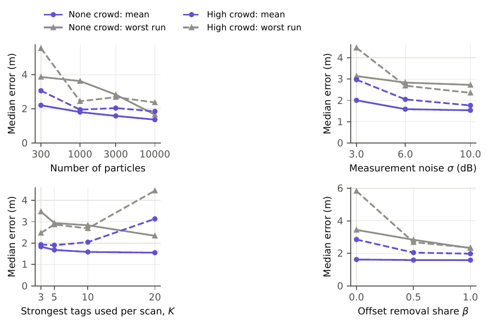

# Indoor Localisation with Particle Filters

Tracking one person through a large airport terminal using Bluetooth Low Energy (BLE)
beacons, the phone's step detector and a particle filter. The radio signal is simulated
with ray tracing (NVIDIA Sionna RT), so every beacon reading in the terminal is
physically based rather than drawn from a formula.

<p align="center">
  
</p>

<p align="center">
  
</p>

Both animations show the same walk at 3× speed. The yellow (3D) or blue (top-down) figure
is the true person, the orange or magenta dots are the particles, and the cyan or orange
line is the filter's estimate.

## Results

Pooled over 40 simulated 10-minute walks (10 walks at each of 4 crowd levels, from no
crowd to 2000 other people), 3000 particles:

| Filter | Median error | 90th percentile |
|---|---|---|
| Fingerprint map, 3 m survey spacing | **1.30 m** | 2.83 m |
| Fingerprint map, 6 m survey spacing | 1.70 m | 3.66 m |
| Fingerprint map, 12 m survey spacing | 2.44 m | 5.72 m |
| Multi-wall path loss | 3.13 m | 7.17 m |
| Plain path loss | 3.45 m | 7.64 m |
| BLE centroid, no filter | 8.40 m | 17.23 m |
| Steps only, no radio | 24.56 m | 96.0 m |

One filter cycle takes about 7–8 ms per scan on a single CPU core.

<p align="center">
  
</p>

The particle cloud starts around the strongest beacons and contracts onto the person
within seconds:

<p align="center">
  
</p>

<p align="center">
  
</p>

Crowds add 0.3–0.6 m of error to the fingerprint filters:

<p align="center">
  
</p>

## The simulated terminal

A 250 m × 60 m terminal: a row of shops, food courts, toilets and lounges with glass or
drywall fronts, a 20 m wide concourse with pillars, and eight gates. 100 BLE beacons are
mounted on ceilings and pillars, about one per 150 m².

<p align="center">
  
</p>

- **Radio:** Sionna RT ray tracing at 2.426 GHz, 0.5 m cells, up to 8 bounces, with ITU
  materials for concrete, plasterboard, glass and ceiling board.
- **Phone readings:** correlated shadowing, Rician fading, body blocking up to 10 dB,
  5 dB per person in the way (up to 15 dB), occasional deep fades, a per-phone offset,
  receiver noise, a −95 dBm sensitivity limit and missed scans.
- **Motion:** walks with pauses, a step detector with stride and heading noise, gyro bias
  and missed steps.
- **Site survey:** what an installer would measure in the empty building, on a 3 m grid.
  The filter only ever sees this survey, never the ray-traced maps.

## The filter

Each particle carries a position, a heading, a gyro bias and a stride scale.

1. **Predict on every detected step:** each particle moves by its own stride and
   heading, with noise. A particle whose step crosses a wall gets zero weight.
2. **Update on every BLE scan (1 Hz):** take the 10 strongest beacons, compare their RSSI
   with what the measurement model expects at each particle, and weight with a Gaussian
   likelihood (σ = 6 dB). Half of the scan's mean offset is removed first, to absorb the
   phone's unknown offset.
3. **Resample** (systematic) when the effective sample size falls below N/2, then
   roughen slightly and inject 1% of particles near the strongest beacons so the filter
   can recover if it gets lost.
4. **Estimate** is the weighted mean of the particles.

Three measurement models share everything else:

| Model | Expected RSSI at a particle |
|---|---|
| Plain path loss | A − 10·n·log₁₀(d) |
| Multi-wall | A − 10·n·log₁₀(d) − Σ (walls crossed × loss per wall type) |
| Fingerprint | bilinear interpolation of the surveyed RSSI map (3, 6 or 12 m spacing) |

<p align="center">
  
</p>

A parameter study on the 6 m fingerprint filter covers particle count, measurement
noise σ, number of beacons per scan and the offset-removal share:

<p align="center">
  
</p>

The full write-up, with the maths, implementation details and discussion, is in
[`report/main.pdf`](report/main.pdf).

## Repository layout

```
indoor_loc/            floor plan, beacon layouts, scene export, sensor models
indoor_loc/filters/    common.py (shared filter), plain.py, multi_wall.py, fingerprint.py
scripts/               simulation, evaluation, report and replay scripts
scripts/animation/     Isaac Sim render and top-down video of one walk
report/                LaTeX report and figures
tests/                 unit tests
data/scene/            exported 3D scene for Sionna
```

## Running it

```bash
conda env create -f environment.yml
conda activate indoor-loc
pytest
```

The radio maps, simulation logs and survey are not in the repository (they are large and
generated). To rebuild them (ray tracing needs Sionna RT and a CUDA GPU):

```bash
python scripts/export_scene.py                                   # 3D scene for Sionna
python scripts/generate_radio_maps.py --set B_even_ceiling_15m --band ble --samples 2e8 --depth 8
python scripts/generate_radio_maps.py --set candidates --band ble --samples 2e8 --depth 8
python scripts/select_layout.py                                  # builds the final 100-beacon layout
python scripts/survey.py                                         # site survey -> data/survey.npz
python scripts/simulate.py --crowd medium --seed 1               # one 10-minute walk
```

Then run a filter on a walk and replay it:

```bash
python scripts/run_filter.py data/sim/E_B_plus_extras__medium__seed1.npz --filter fingerprint_6m
python scripts/replay.py data/sim/E_B_plus_extras__medium__seed1.npz \
    --estimate data/sim/E_B_plus_extras__medium__seed1__fingerprint_6m_estimate.npz
```

`--filter` is one of `plain`, `multi_wall`, `fingerprint_3m`, `fingerprint_6m`,
`fingerprint_12m`.

To reproduce every number and figure in the report:

```bash
python scripts/report_experiments.py
python scripts/report_stale_map.py
python scripts/report_figures.py
cd report && pdflatex main.tex && pdflatex main.tex
```

## Limitations

Everything here is simulated: one building, one phone model, and a person who walks on a
single floor. The fingerprint maps assume the survey still matches the building; a map
that is 5 dB out of date roughly doubles the error. Testing with real phones and beacons
is the next step.
